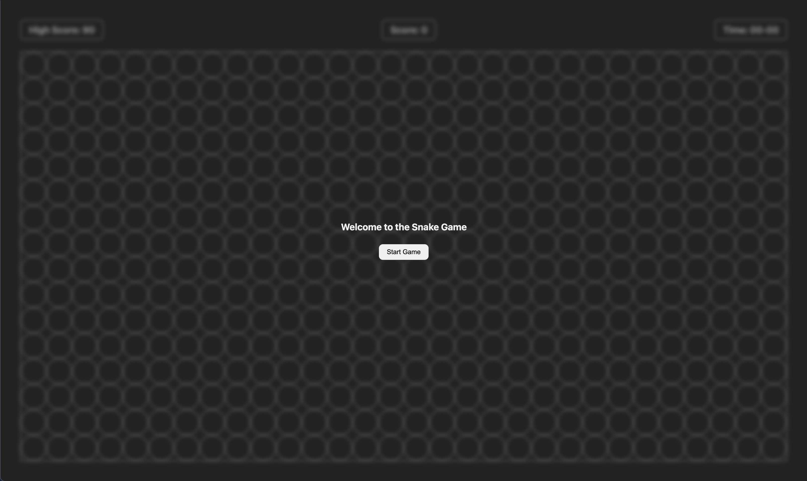
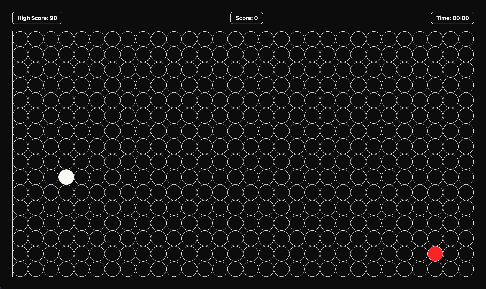

# 🐍 Snake Game

A classic **Snake Game** developed using HTML, CSS and JavaScript. Control the snake, collect food, increase your score and try to beat your highest score!

A simple browser-based arcade game built using fundamental web development technologies.

---

## ✨ Features

- 🐍 Classic Snake gameplay
- 🎮 Keyboard-based movement controls
- 🍎 Food collection and score tracking
- 🏆 High score tracking using Local Storage
- ⏱️ Game timer
- 💥 Game Over detection
- 🔄 Restart functionality
- 🌙 Dark-themed gaming interface
- 📱 Browser-based gameplay

---

## 🛠️ Tech Stack

- HTML5
- CSS3
- JavaScript
- Browser Local Storage

---

## 📸 Game Screenshots

### 🎮 Game Homepage

<!-- Add your game screenshot here -->



### 🐍 Gameplay

<!-- Add your gameplay screenshot here -->



---

## 🚀 Getting Started

### 1. Clone the repository

```bash
git clone https://github.com/priyanshisingh0210/Snake-Game.git
```

### 2. Open the project folder

```bash
cd Snake-Game
```

### 3. Run the game

Open `index.html` in your browser.

No additional installation or dependencies are required.

---

## 🎮 How to Play

1. Click on **Start Game** to begin.
2. Use the arrow keys to control the snake.
3. Collect food to increase your score.
4. Avoid hitting the walls.
5. Try to achieve the highest possible score.
6. Click **Restart Game** to play again after Game Over.

### Controls

| Key | Action |
|---|---|
| ↑ | Move Up |
| ↓ | Move Down |
| ← | Move Left |
| → | Move Right |

---

## 📂 Project Structure

```text
Snake-Game/
│
├── index.html
├── style.css
├── script.js
├── assets/
│   └── screenshots/
│       ├── home-page.png
│       └── gameplay.png
│
└── README.md
```

---

## 🎯 Project Objective

The objective of this project is to develop a classic Snake Game using HTML, CSS and JavaScript.

It demonstrates fundamental web development concepts such as DOM manipulation, event handling, JavaScript functions, game logic and browser Local Storage.

---

## 🔮 Future Improvements

- Multiple difficulty levels
- Sound effects
- Mobile touch controls
- Pause and resume functionality
- Improved game animations
- Additional game modes

---

## 👩‍💻 Author

**Priyanshi Singh**

- GitHub: [priyanshisingh0210](https://github.com/priyanshisingh0210)

---

## ⭐ Show Your Support

If you enjoyed this project, consider giving the repository a ⭐ on GitHub.
